# SPACE OS — TRẠM DECOR VŨ TRỤ (ESP32-S3 FREEFORM COPPER SCULPTURE)
## Tài liệu Kiến trúc Hệ thống & Hiện trạng Dự án Chính thức
*Phiên bản Firmware: Space OS v3.2.5 | Cập nhật: 22/10/2026*

---

## 1. Tổng quan Dự án

Dự án **Trạm Decor Bàn Làm Việc Thông Minh (Space Station Decor)** là một tác phẩm công nghệ kết hợp giữa **Nghệ thuật Điêu Khắc Mạch Điện Bằng Đồng Thau (Freeform Brass/Copper Circuit Sculpture)** và **Hệ điều hành Nhúng Đa Nhiệm (Space OS)** chạy trên vi điều khiển **ESP32-S3 (N16R8: 16MB Flash, 8MB Octal PSRAM)**.

Thiết bị không chỉ là một chiếc đồng hồ để bàn trang trí độc bản phong cách Cyberpunk / Retro-Futuristic, mà còn tích hợp đầy đủ hệ sinh thái thông minh:
- **Màn hình màu IPS 2.4" 240x320 (ST7789VW)** giao diện Symbian S40 Nokia kinh điển với 19 chế độ hiển thị chuyên sâu.
- **Hệ thống Âm thanh Số I2S Kép Độc Lập**: DAC khuếch đại MAX98357A (Loa 3W) và Microphone MEMS kỹ thuật số INMP441.
- **Trợ lý Giọng nói Trí Tuệ Nhân Tạo (XiaoZhi AI Hub)** đàm thoại trực tiếp hai chiều thời gian thực qua WebSocket & Opus Codec.
- **Thời tiết Thực tế Toàn Cầu (Open-Meteo & IP Geolocation)** hiển thị nhiệt độ ngoài trời, độ ẩm, mã thời tiết WMO và biểu tượng vector sinh động.
- **Hệ thống Cảm biến Môi trường SHT31 & Cảm ứng Điện dung TTP223** đo nhiệt độ, độ ẩm phòng chính xác và nhận diện thao tác chạm vỏ đồng.
- **Hệ thống Truyền động & Ánh sáng Nghệ thuật**: Cối xay gió N20 (cầu H L298N), 2 đèn ống năng lượng Edison filament dẻo (nhịp theo nhạc VU meter, phản hồi giọng AI), 2 thanh LED nước chảy sao băng COB.
- **Kiến trúc Bảo vệ FlashGuard & Bộ đệm Telemetry 1MB PSRAM**: Lưu trữ 87,381 mẫu dữ liệu chuỗi thời gian liên tục 48.5h không ghi mòn bộ nhớ Flash.
- **Nhật Ký Hoạt Động Hệ Thống Toàn Diện (Smartphone-Style Syslog & Thẻ Nhớ SD)**: Bộ đệm kép Octal PSRAM 128KB non-blocking kết hợp ghi tuần tự xuống thẻ MicroSD (`/logs/sys_YYYYMMDD.log`), tự động xoay vòng 512KB, định kỳ 10 phút chụp ảnh kiểm tra sức khỏe thiết bị (`[SNAPSHOT]`).
- **Giao diện Web Dashboard Quản trị Toàn diện**: Điều khiển thời gian thực, bàn phím ảo, tải nhạc/hình nền, vẽ biểu đồ canvas, Web Terminal xem log thời gian thực và nâng cấp phần mềm OTA trực tiếp từ GitHub.

---

## 2. Hiện trạng Phần cứng Thực tế (Official Hardware Pinout)

Hệ thống được thi công bằng kỹ thuật uốn thanh đồng nguyên khối $1.2\,\text{mm}$ làm khung chịu lực kiêm mặt phẳng tiếp địa (GND) chung, kết hợp dây đồng men cách điện siêu nhỏ $0.1\,\text{mm}$ chạy ẩn mặt sau.

### Bảng phân bổ chân GPIO vi điều khiển ESP32-S3 DevKitC-1:

| Khối Chức Năng | Linh Kiện Phần Cứng | Chân Giao Tiếp ESP32-S3 | Chế Độ & Giao Thức |
| :--- | :--- | :--- | :--- |
| **Màn hình ST7789** | 2.4" IPS TFT 240x320 | **MOSI: GPIO 11, SCK: GPIO 12, DC: GPIO 13, CS: GPIO 14, RST: GPIO 10, BL: GPIO 7** | Phần cứng SPI 80 MHz, PWM Backlight (LEDC kênh 0) |
| **Thẻ nhớ MicroSD** | Wemos D1 MicroSD Shield | **MOSI: GPIO 40, MISO: GPIO 41, SCK: GPIO 42, CS: GPIO 39** | Bus SPI phần cứng riêng biệt, định dạng FAT32 |
| **Âm thanh Ra (Loa)** | Module MAX98357A I2S DAC | **DIN: GPIO 15, BCLK: GPIO 16, LRC/WS: GPIO 17** | Cổng I2S1 chuyên dụng, phát MP3, WAV, TTS Opus |
| **Âm thanh Vào (Mic)** | Module INMP441 MEMS Mic | **SCK: GPIO 4, WS: GPIO 5, SD: GPIO 6** | Cổng I2S0 chuyên dụng, thu âm 16kHz 16-bit Mono |
| **Cảm biến Môi trường** | Module SHT31 | **SDA: GPIO 8, SCL: GPIO 9** | Bus phần cứng I2C (tần số 400 kHz) |
| **Cảm biến Chạm** | Module TTP223 | **SIG: GPIO 20** | Active HIGH, kết nối vỏ đồng trang trí chạm tay |
| **Bàn phím 7 Nút** | Keypad 7 phím thang điện trở | **KEY_ADC: GPIO 3 (ADC1_CH2)** | 1 dây tín hiệu chia thang điện áp qua trở kéo lên $10\,\text{k}\Omega$ |
| **Trạng thái Sạc & Pin** | Mạch sạc TP4056 & Pin 18650 | **CHG_STAT: GPIO 46, BAT_ADC: GPIO 2** | GPIO 46 (Input-Only đọc STAT), GPIO 2 đọc điện áp pin |
| **Cối xay gió** | Motor giảm tốc N20 + Vành LED | **IN1: GPIO 1** | Mạch cầu H L298N Mini / MX1508, điều tốc PWM |
| **Đèn Ống Edison** | 2 Ống LED Edison Filament 30mm | **Sườn TRÁI: GPIO 47, Sườn PHẢI: GPIO 21** | Điều chế xung PWM (LEDC), trở nối tiếp $47\,\Omega$ |
| **Đèn Dải Tín hiệu** | 2 Thanh LED Nước Chảy COB 3V | **Thanh TRÁI: GPIO 18, Thanh PHẢI: GPIO 38** | Điều khiển bật/tắt Digital HIGH |
| **Đèn Trạng Thái Bo** | WS2812 RGB Onboard | **DATA: GPIO 48** | Báo trạng thái Wi-Fi, SoftAP và cảnh báo hệ thống |

---

## 3. Hệ Điều Hành Space OS v3.2.5 & 19 Chế Độ Màn Hình

Giao diện đồ họa được tối ưu hóa toàn diện trên màn hình dọc 240x320 pixel, kế thừa phong cách điện thoại Nokia Symbian S40 kết hợp giao diện Cyberpunk HUD với 6 bộ Theme màu sắc (Vũ trụ, Chill Thảo Mộc, Mecha, Lofi Hoàng Hôn, S40 Cổ Điển, Mèo Gome Chibi):

```mermaid
flowchart TD
    Standby["Mode 0: Màn Hình Chờ (Standby Clock & Wallpaper)"]
    Menu["Mode 4: Menu Chính Symbian S40 (Lưới 15 Biểu Tượng 4x3)"]
    AOD["Chế độ Khóa Màn Hình (Always On Display / Sleep)"]
    
    Standby -- "Bấm MENU" --> Menu
    Standby -- "Bấm EXIT" --> AOD
    AOD -- "Bấm phím bất kỳ" --> Standby
    Menu -- "Bấm EXIT" --> Standby
    
    Menu --> App1["Mode 5: Hình Nền"]
    Menu --> App2["Mode 6: Cài Đặt Hệ Thống"]
    Menu --> App3["Mode 2: PC Status HUD"]
    Menu --> App4["Mode 7: Thư Viện Ảnh"]
    Menu --> App5["Mode 10: Quản Lý Bộ Nhớ SD"]
    Menu --> App6["Mode 11: Trợ Lý XiaoZhi AI"]
    Menu --> App7["Mode 12: Trình Phát Nhạc"]
    Menu --> App8["Mode 13: Cụm Tiện Ích Đồng Hồ"]
    Menu --> App9["Mode 14: Lịch Vạn Niên"]
    Menu --> App10["Mode 8: Thông Tin Thiết Bị & OTA"]
    Menu --> App11["Mode 3: Sóng Âm & Thẻ SD (Chuyển trang Trái/Phải)"]
    Menu --> App12["Mode 15: Trung Tâm Trò Chơi"]
    Menu --> App13["Mode 16: Mã QR Cài Đặt Wi-Fi"]
    Menu --> App14["Mode 18: Quản Lý Mạng Wi-Fi"]
    Menu --> App15["Mode 19: Giám Sát Hệ Thống (Cột Biểu Đồ Neon)"]
```

### Danh sách chi tiết 19 Chế độ Hiển thị:
1. **Mode 0: Màn Hình Chờ (Standby Screen)**: Đồng hồ trung tâm (hỗ trợ 4 kiểu: Digital, Retro Flip, Analog, Compact), cập nhật vùng nhỏ 240x44 không quét lại nền; 2 viên thuốc kính mờ trên đỉnh (Wi-Fi SSID & Tên thiết bị); Widget thời tiết kính mờ đáy màn hình (thời tiết Open-Meteo, icon vector, địa điểm và nhiệt độ phòng SHT31).
2. **Mode 1: Biểu Cảm XiaoZhi AI**: Đôi mắt biểu cảm Neon sống động với 12 trạng thái cảm xúc (Blink, Happy, Looking 4 hướng, Angry, Confused, Wink, Sleepy).
3. **Mode 2: PC Status HUD**: Màn hình giám sát máy tính thời gian thực (CPU, GPU, RAM, Nhiệt độ, Network) với 4 phong cách giao diện (Gauges, Bars, Graphs, Cyberpunk Matrix).
4. **Mode 3: Chẩn Đoán Ngoại Vi & Thẻ Nhớ SD (2 Trang Tương Tác)**:
   - **Trang 1 (Ngoại vi & Sóng âm)**: Đo phổ sóng âm thời gian thực 65ms từ Micro MEMS INMP441, đọc nhiệt ẩm phòng SHT31 và trực quan hóa điện áp 7 phím bấm ADC.
   - **Trang 2 (Kiểm tra Thẻ nhớ SD)**: Đo điện áp thực tế 4 chân SPI (CS, MOSI, MISO, SCK), mã phản hồi lệnh CMD0 hex, dung lượng Total/Used/Free và tình trạng tiếp xúc khay thẻ.
   - Chuyển đổi giữa 2 trang bằng phím Trái / Phải (`KEY_LEFT` / `KEY_RIGHT`), phím OK quét lại thẻ nhớ, phím EXIT quay về Menu S40.
5. **Mode 4: Giao Diện Điều Khiển Symbian S40**: Lưới 15 biểu tượng ứng dụng bố cục 4x3 có cuộn dọc mượt mà, khung viền chọn phát sáng theo theme.
6. **Mode 5: Trình Quản Lý Hình Nền**: Đổi hình nền động từ thẻ nhớ SD hoặc Flash LittleFS, hỗ trợ nạp nhanh ảnh định dạng `.rgb565` (153.6KB) không tốn CPU giải mã.
7. **Mode 6: Cài Đặt Hệ Thống**: 14 mục cài đặt (6 theme màu, độ sáng màn hình, thời gian chờ tắt màn hình, kiểu AOD, âm lượng, âm phím, nhạc chuông báo thức, độ nhạy mic, motor cối xay, các cụm LED).
8. **Mode 7: Thư Viện Hình Ảnh**: Xem duyệt slide ảnh chất lượng cao trên thẻ nhớ SD.
9. **Mode 8: Thông Tin Thiết Bị & Cập Nhật OTA**: 3 trang chi tiết (Hệ thống & Mạng, Bộ nhớ & Phân vùng OTA, Mã QR kết nối Wi-Fi) và hộp thoại kiểm tra nâng cấp firmware trực tiếp từ GitHub với so sánh SemVer an toàn.
10. **Mode 9: Đo Kiểm Tốc Độ Thẻ Nhớ**: Benchmark tốc độ đọc/ghi khối tuần tự trên MicroSD FAT32 (được tích hợp song song trong Mode 3).
11. **Mode 10: Quản Lý Thẻ Nhớ & Tệp Tin (File Explorer)**: Đệm biểu tượng nhận diện từng định dạng tệp (📁 Thư mục, 🎵 Âm thanh, 🖼️ Hình ảnh, ⚙️ Cấu hình, 📦 Firmware), tự động rút gọn tên tệp dài `...`.
12. **Mode 11: Trợ Lý Giọng Nói XiaoZhi AI**: Màn hình chia 2/3 (Mắt AI) + 1/3 (Khung hội thoại tròn dòng tự động cuộn chữ tiếng Việt), tích hợp quy trình hiển thị mã OTP liên kết với XiaoZhi Cloud Hub.
13. **Mode 12: Trình Phát Nhạc Đa Phương Tiện**: Phát nhạc MP3/WAV từ thẻ nhớ SD, đọc và hiển thị Album Cover Art (`[tên_bài].jpg`, `cover.jpg`) trong khung neon 68x68, tự động chuyển về đĩa than cổ điển Vinyl Turntable xoay 360° nếu không có ảnh bìa; cột sóng âm 8 băng tần nhịp theo nhạc.
14. **Mode 13: Bộ Tiện Ích Thời Gian**: Báo thức 3 mốc kèm hoãn chuông (Snooze), Đồng hồ bấm giờ (Stopwatch), Hẹn giờ đếm ngược (Countdown Timer) và Chỉnh giờ thủ công.
15. **Mode 14: Lịch Vạn Niên (Solar / Lunar Calendar)**: Tra cứu lịch dương và âm lịch truyền thống, can chi, ngày hoàng đạo.
16. **Mode 15: Trung Tâm Trò Chơi (Retro Game Center)**: 3 tựa game cổ điển điều khiển bằng cụm 7 phím bấm (Rắn săn mồi Snake, Bắn ruồi không gian Space Invaders, Flappy Bird).
17. **Mode 16: Mã QR Cài Đặt Nhanh**: Tự động sinh mã QR chuẩn xác trên màn hình để điện thoại quét kết nối Wi-Fi SoftAP hoặc mở trang cấu hình Web.
18. **Mode 17: Trình Phát Stream Video/Audio Trực Tuyến**: Nhận luồng video JPEG và audio PCM UDP từ máy tính / server qua cổng mạng.
19. **Mode 18: Quản Lý Kết Nối Wi-Fi**: Quét danh sách sóng Wi-Fi xung quanh, xem trạng thái kết nối, độ mạnh sóng RSSI và chuyển đổi AP tiện lợi.
20. **Mode 19: Giám Sát Hệ Thống Telemetry 48 Giờ**: Biểu tượng cột biểu đồ Neon (Bar Chart), vẽ đồ thị tương tác trực tiếp trên màn hình ST7789 từ 1MB circular buffer trong PSRAM với 4 chỉ số (Nhiệt độ, Độ ẩm, CPU, Pin) và 4 khung thời gian (1h, 6h, 24h, 48h). Đã đồng bộ trực quan lên Web Demo Screen.

---

## 4. Các Công Nghệ Cốt Lõi Đã Triển Khai

### 4.1 Cơ chế Bảo vệ Bộ nhớ FlashGuard
- Bộ nhớ Flash SPI trên vi điều khiển có tuổi thọ hữu hạn số lần xóa/ghi sector (~100,000 chu kỳ).
- **Giải pháp FlashGuard**:
  - Chuyển 100% dữ liệu telemetry sang **1MB PSRAM Circular Buffer** (dung lượng 87,381 mẫu), hoàn toàn không ghi vào Flash.
  - Bộ đệm ghi hoãn (Write Debouncer 2.0 giây) và kiểm tra dữ liệu thay đổi thực sự (`dirty check`) ngăn chặn tình trạng kéo thanh trượt giao diện Web ghi liên tục vào Preferences NVS.

### 4.2 Tối ưu Đồ họa ST7789 ở 80 MHz SPI
- Driver xuất hình trực tiếp qua phần cứng SPI 80 MHz của ESP32-S3, tối đa hóa băng thông truyền dữ liệu.
- Cơ chế **Đệm Đồng Hồ Cục Bộ (Partial Clock Strip Buffer 240x44)**: Chỉ cập nhật vùng số giờ phút giây nổi trên nền ảnh mà không quét lại toàn màn hình.
- Phục hồi hình nền tức thì từ bộ đệm 4 dải trong RAM/PSRAM (`standbyStripCache`) mất chưa đầy 1 ms.
- Cơ chế an toàn đa nhân (**Thread-Safe Display Flag** `s_standbyNeedsRedraw`): Mọi tác vụ ngầm chạy trên Core 0 (như cập nhật thời tiết hay kiểm tra mạng) chỉ gửi cờ báo hiệu, nhường việc xuất bus SPI đồng bộ cho Core 1, triệt tiêu hoàn toàn hiện tượng xung đột bus gây đè chữ và rách hình.

### 4.3 Trợ lý Trí Tuệ Nhân Tạo XiaoZhi Voice Chat
- Kết nối WebSocket hai chiều bảo mật trực tiếp tới XiaoZhi Cloud AI Server.
- Tự động mã hóa/giải mã giọng nói qua thư viện Opus 16kHz.
- Quy trình đăng ký và liên kết thiết bị nhanh chóng thông qua mã OTP hiển thị trực quan trên màn hình.

---

## 5. Đánh Giá Hiện Trạng Xử Lý UI & Hệ Thống Nhật Ký (Space OS v3.2.5)

Dựa trên quá trình vận hành thực tế, các hạng mục kiến trúc then chốt đã được nâng cấp toàn diện:

| Hạng Mục | Hiện Trạng & Vấn Đề Tiềm Ẩn | Giải Pháp Kỹ Thuật Đã Triển Khai |
| :--- | :--- | :--- |
| **1. Vòng lặp chính (`loop()`)** | Nhiều tác vụ gọi tuần tự trong `loop()`, nguy cơ tác vụ I/O gây lag UI. | **Task Profiler**: Đo lường độ trễ chi tiết theo $\mu\text{s}$ cho 10 tác vụ trong `loop()` bằng `esp_timer_get_time()`, tính toán Loop FPS và cảnh báo tác vụ vượt 10ms (`slowCount`). |
| **2. Đồng hồ & Thời tiết Màn hình chờ** | Thay đổi nhiệt độ phòng hay giây đồng hồ có thể gây giải mã lại ảnh nền. | **Micro-Region Update**: Duy trì `clockCanvas` 240x44; bổ sung `drawStandbyWeatherPillOnly()` vẽ riêng viên thuốc 196x30 ($y=256..286$), giữ nguyên 100% hình nền JPEG không bị chớp nháy. |
| **3. Luồng Chuyển Màn hình** | Chuyển app đột ngột trong lúc phát nhạc hay stream có thể gây nghẽn tài nguyên. | **State Decoupling**: Bộ ba vòng đời `onExitMode`, `onEnterMode`, `switchModeSafe`; tự động dừng phát nhạc MP3, đóng UDP stream, giải phóng buffer trước khi nạp giao diện mới. |
| **4. Quản lý Bộ nhớ (Heap & PSRAM)** | Nguy cơ phân mảnh bộ nhớ khi chạy nhiều ngày liên tục. | **Memory Watermark Monitor**: Giám sát liên tục `MinFreeHeap`, `MinFreePsram`, `MaxAllocHeap` và bộ đếm lỗi cấp phát `allocFailures` trong `HardwareManager`, đồng bộ lên Web `/api/system_info`. |
| **5. Nhật Ký Hoạt Động Real-time** | Con trỏ xả thẻ nhớ trùng với con trỏ đọc web gây trắng bảng log; chưa có visual terminal cho bản sao số. | **Decoupled PSRAM History & Sci-Fi Terminal Engine (v3.2.1)**: Tách rời `s_historyCount` khỏi `s_sdFlushTail`; Fallback 8KB SD khi khởi động; Web Terminal chuẩn Sci-Fi (3 theme Matrix/Cyberpunk/Pip-Boy, CRT Scanlines, Client-side filter, hàm tái sử dụng `createSciFiLogTerminal` cho tab 3D). |
| **6. Gộp Chẩn Đoán & Menu S40 (v3.2.2)** | Quá nhiều icon dàn trải (test thẻ nhớ riêng, test ngoại vi riêng); "Xu hướng" thiếu trực quan trên Web. | **Unified Hardware Diagnostics & 15-App Grid**: Gộp test thẻ nhớ và test ngoại vi vào 1 icon "Sóng âm" (Mode 3) chuyển trang bằng phím ◄/►; đổi tên "Xu hướng" thành "Hệ thống" với icon Biểu đồ cột Neon (Bar Chart); bổ sung giao diện Web Demo cho Mode 19. |
| **7. Ổn Định Đồng Bộ Giờ Real-Time & Khắc Phục Lỗi Reset (v3.2.3)** | Gọi `SystemLogger` trong lwIP TCP callback gây tràn stack Core 0 (<3KB) dẫn đến Guru Meditation reset; `configTime()` lặp lại làm reset socket SNTP. | **Decoupled Core 1 TimeManager**: Loại bỏ hoàn toàn lwIP SNTP callback; chuyển cơ chế phát hiện đồng bộ về Core 1 thông qua atomic RTC check `time(nullptr) >= 1700000000` trong `TimeManager::loop()`; chỉ gọi `configTime()` duy nhất 1 lần khi Wi-Fi kết nối; tự động kích hoạt cờ vẽ lại Standby an toàn tuyệt đối. |
| **8. Khắc Phục Lệch Icon Menu Theme Mèo Gome Chibi (v3.2.4)** | Mảng icon Gome cũ vẫn còn icon thẻ nhớ ở slot 11 và chỉ có 13 phần tử khiến "Trò chơi" hiển thị icon thẻ nhớ và các icon sau bị lùi 1 vị trí. | **15-Icon Full Alignment**: Cập nhật `GOME_ICON_COUNT = 15`; loại bỏ icon thẻ nhớ riêng; chuyển icon Trò chơi (`gome_39.png`) về đúng slot 11; bổ sung icon Mã QR Chibi (`gome_qr.png`) ở slot 12, Wi-Fi (`gome_27.png`) ở slot 13 và Bánh răng Hệ thống (`gome_40.png`) ở slot 14. |
| **9. Tách KeypadTask FreeRTOS Sang Core 0, Instant Wake-up & Khắc Phục Treo Loop WebSocket (v3.2.5)** | Vòng lặp `loop()` trên Core 1 bị nghẽn 5000ms (0.2 FPS) do `XiaoZhiClient` huỷ và tạo lại WebSocket liên tục khi mất mạng; bàn phím và chạm TTP223 quét trong `loop()` bị bỏ qua, màn hình AOD bị đơ không thức dậy được sau 36.5h chạy liên tục. | **Decoupled Core 0 KeypadTask & Non-blocking WebSocket Backoff**: Chuyển toàn bộ quét phím ADC 7 nút và cảm ứng TTP223 sang task FreeRTOS riêng trên Core 0 (Priority 3, 10ms = 100Hz); đánh thức màn hình tức thì (<10ms) qua LEDC PWM phần cứng; chuyển WebSocket XiaoZhi sang cơ chế phục hồi bất đồng bộ (Async WsRestartTask) với Exponential Backoff (15s..120s), giải phóng hoàn toàn Core 1 duy trì 800+ FPS; bổ sung log vi giây ($\\mu\\text{s}$) từng task vào bản tin Snapshot định kỳ 10 phút trên thẻ nhớ SD. |

---

## 6. Lộ Trình Phát Triển Tiếp Theo (Next Milestones)

1. **Sci-Fi Command Center / Fallout Pip-Boy HUD (Bản Sao Số 3D - Digital Twin)**:
   - Dựng model 3D tương tác của trạm từ ảnh chụp thực tế bằng Blender.
   - Bổ sung Tab 3D WebGL (Three.js) trên Web Dashboard với cơ chế Tải lười (Lazy-loading từ GitHub/CDN).
   - Mô phỏng 3D xoay 360° trạm bên trái (click vào module để camera zoom tới và hiện popup trạng thái), kết hợp màn hình Terminal DOS CRT quét dòng bên phải.
2. **Mở rộng Hệ sinh thái Trợ lý AI XiaoZhi**:
   - Nâng cấp độ nhạy thu âm mic INMP441 và thuật toán lọc nhiễu nền khi loa phát công suất lớn.
   - Thêm các kịch bản phản hồi nhà thông minh (Smart Home IoT Control) từ câu lệnh giọng nói.
